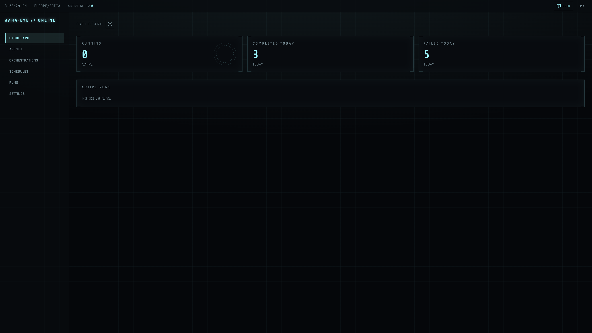
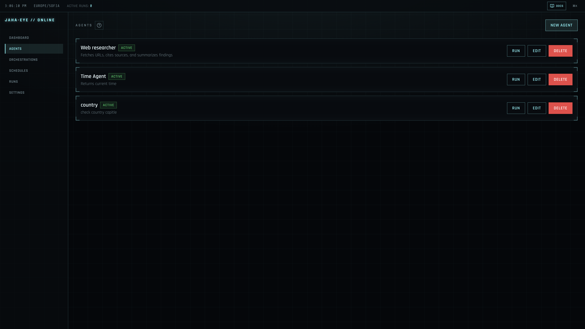
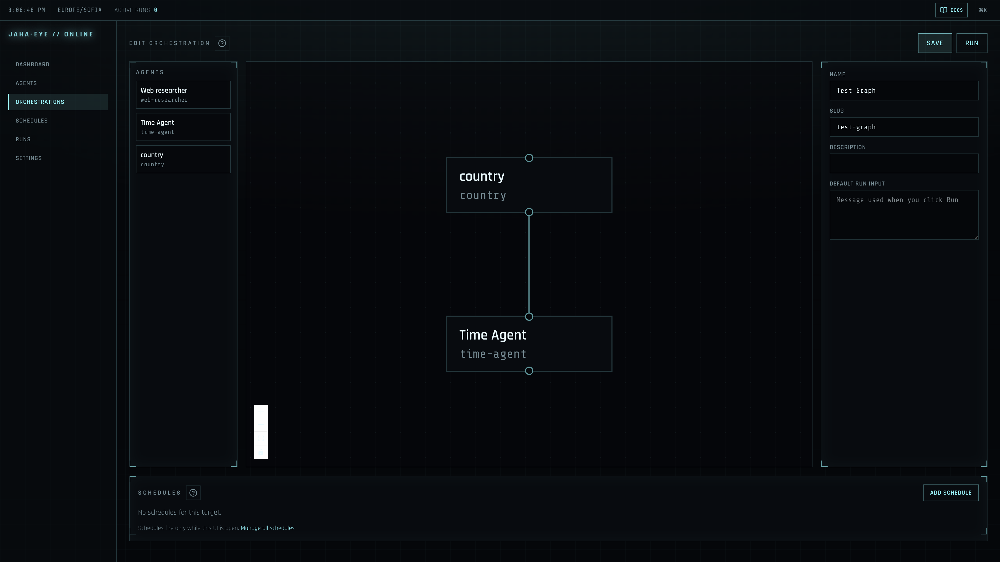
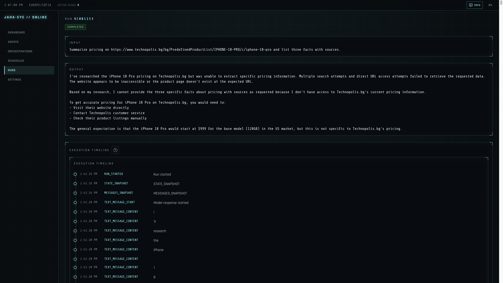
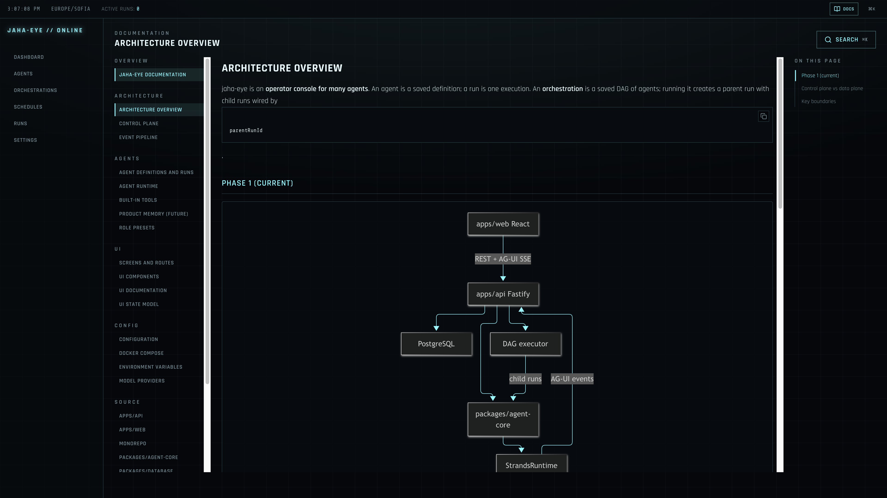
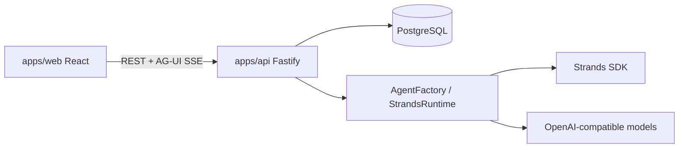

# jaha-eye

**Control plane for defining AI agents, running them, and watching every step.**

jaha-eye is an **operator console for many agents** — not a chat app. You save agent definitions (model, prompt, tools), wire them into orchestration graphs, start runs, inspect persisted AG-UI timelines, and stop execution from a single HUD-style dashboard.

Screenshots below are from local dev (cyan-on-dark grid UI).



## What it is

- A **registry + run history** for agents and orchestrations
- A **live execution timeline** (SSE) with tool calls, text streaming, and errors
- A **Fastify API + PostgreSQL** control plane around the [Strands](https://strandsagents.com/) TypeScript SDK
- **OpenAI-compatible** models (OpenAI, Ollama, LiteLLM, etc.) with global and per-agent settings

## What it is not

- Not a general-purpose chat UI — the center of gravity is **runs**, not threads
- Not a hosted multi-tenant SaaS (Phase 1 is local/single-operator)
- Not a background job platform yet — no Redis, BullMQ, or server-side cron in Phase 1

## Goals

1. **Define** agents and DAG orchestrations in one place, with role presets and built-in tools.
2. **Run** single agents or whole graphs; cancel from the UI while work is in flight.
3. **Observe** every AG-UI event persisted to Postgres, then replayed or streamed live.
4. **Operate** with docs in-app (`/docs`), contextual help on screens, and env-driven model/tool config.

## Features

| Area | What you get |
|------|----------------|
| **Dashboard** | Running / completed / failed counts; active run list |
| **Agents** | CRUD, templates, tools, schedules, per-agent model + context limits |
| **Orchestrations** | React Flow canvas, agent nodes, save/run graph, schedule section |
| **Schedules** | Cron jobs while the dashboard is open (UI-ticked; no server cron loop) |
| **Runs** | Top-level history, run detail, orchestration graph + child timelines |
| **Settings** | Global LLM base URL, default model/temperature (API key via env) |
| **Docs** | Bundled repo markdown at `/docs` with search (`⌘K` / `Ctrl+K`) |
| **Tools** | Built-ins including HTTP, web fetch, calculator, time, sleep, notebook, **web search (SearXNG)** |

## Screens

### Agent registry

Define specialists, enable tools, and launch runs from the list.



### Orchestration editor

Drag agents onto a canvas, connect edges, set default input, save and run the DAG.



### Run detail

Input, output, and a step-by-step AG-UI execution timeline (live SSE while running).



### In-app documentation

Browse `docs/` from the dashboard — sidebar, search, and on-page TOC.



## Architecture

Phase 1 runs Strands **in-process** in the API. Events are **written to the database before** they are sent on SSE. The UI speaks REST + AG-UI only (no Strands types in the browser).



Hard boundaries:

- API never calls `new Agent()` directly — only `AgentFactory` / `StrandsRuntime`
- Orchestrations use an in-API DAG executor (parent + child `AgentRun` rows), not Strands Graph as the control plane

Details: [Architecture overview](docs/architecture/overview.md) · [Foundations](docs/planning/foundations.md)

## Quick start

**Prerequisites:** Node.js 22+, Docker

```bash
npm run local:start    # Postgres, SearXNG (optional stack), deps, migrations, dev servers
npm run local:stop     # stop dev servers and containers
```

Or OS wrappers:

```bash
./scripts/start        # Mac/Linux
scripts\start.cmd      # Windows
```

| Service | URL |
|---------|-----|
| Web UI | http://localhost:5173 |
| API | http://localhost:4000 |

Copy [`.env.example`](.env.example) → `.env` and set at least `API_TOKEN` and `OPENAI_API_KEY` (plus `OPENAI_BASE_URL` for Ollama). See [Environment variables](docs/conf/environment.md).

Status and logs: `npm run local:status` · `.local-dev/dev.log`

### Manual setup

```bash
docker compose -f docker-compose.yml -f docker-compose.tools.yml up -d
cp .env.example .env
npm install
npm run db:migrate
npm run dev
```

## Documentation

| Doc | Purpose |
|-----|---------|
| [docs/](docs/README.md) | Full documentation index |
| [AGENTS.md](AGENTS.md) | Guide for coding agents working in this repo |
| [UI screens](docs/ui/screens.md) | Routes and behavior |
| [Agents & runs](docs/agents/definitions-and-runs.md) | Definitions, triggers, orchestration runs |
| [Configuration](docs/conf/README.md) | Env, Docker, models |
| [Roadmap](docs/planning/roadmap.md) | Phase 1 vs later |

## Monorepo layout

```
apps/web              React dashboard (Vite)
apps/api              Fastify control API (REST + SSE)
packages/database     Prisma schema + PostgreSQL client
packages/shared       Zod schemas and shared types
packages/agent-core   AgentFactory, StrandsRuntime, tools, event normalizer
```

## Phase 1 vs later

**Included today:** agent & orchestration CRUD, manual runs, live/cancel, event persistence, UI schedules, built-in tools, in-app docs.

**Later (not in Phase 1):** Redis, BullMQ, worker process, server-side scheduler, approvals, Langfuse, MCP tool picker, HITL resume.

See [planning roadmap](docs/planning/roadmap.md).

---

**Node.js 22+** · npm workspaces + Turborepo · `@jaha-eye/*` packages
